# AGENT-004-J 交付与调用链

2026-11-18，M3穿插M2。当前为本地待用户验收的产品增量；真实Qwen请求0，不commit/push。详见[验证](VERIFICATION.md#agent-004-j-20261118)。I预算练习保留，不等待也不代写。

## G/H/I交付核对

开始HEAD aad9ddba7ab7b6c4b0cb6aacb477584344dbb0b0，16个tracked修改/11个untracked，与I报告一致。I旧日志449 passed/1 skipped、前端91 passed为旧证据，不冒称J重跑。G真实raw只读核对4请求/12,369 tokens，四份独立result逐字结构相等；22份既有历史哈希本轮实际通过。H/I文档记录0真实请求，本轮未发现相反证据。历史结果不按新Schema重新保存。

G的真实preflight仍调用validate_production_subject，保留HEAD/四源码冻结。Fake流程测试只替换这一门控，其他配置/额度/落盘/错误路径继续测试；真实历史完整性由固定旧哈希清单实际核对，CI用合成文件验证篡改/缺失/越界检测。不是只删断言换取全绿，也不要求当前生产代码始终等于G。采样器当前已不适合正式重跑，保留代码用于审计与Fake回归。

## 接续探索的调用链

```mermaid
flowchart LR
  UI["UI：延伸问题草稿，可编辑/放弃"] -->|"明确提交：新问题 + parent_run_id + 时间/预算/精力"| API["API：POST /api/agent/runs"]
  API --> Schema["Schema：knowledge限定、文本长度、旧payload兼容"]
  Schema --> Context["API上下文校验：父Run存在且为原始知识结果；读取原用户材料"]
  Context --> Workflow["Workflow：按父兴趣检索当前Star，读取明确偏好"]
  Workflow --> ModelAdapter["ModelAdapter：新问题 + 原材料 + Star + 限制"]
  ModelAdapter --> Gate["校验：严格DTO、连续原文/元数据、Quest来源和预算等规则"]
  Gate --> Run["新Run：parent_run_id、请求、卡片/不足说明、候选、事件"]
```

HTTP进入时FastAPI先执行Schema校验，再由API做上下文查找；图中Schema置于API之后表示此请求入口的处理流程，不是额外接口。

| 阶段 | 关键输入 | 输出/边界 |
| --- | --- | --- |
| UI | 原卡片follow_up_question、父Run ID | 本地草稿；打开/编辑/放弃无请求。明确提交带原运行时间/预算/精力，含0和null |
| API/Schema | AgentRequest(parent_run_id,text,knowledge,limits)、幂等键 | 验证父ID存在；Collect/其他方向422，不存在404，无卡片/无材料/非原始/错误状态409，替换材料422；失败不创建Run |
| 上下文读取 | AgentRun.state.request | 服务端从数据库读取原始用户learning_source，保留label/url及未独立核实归属；不读取takeaway作为证据 |
| Workflow | 新问题、原材料、父Run关系 | 用父请求兴趣检索当前Star，获取当前明确Preferences，生成阶段仍使用新问题；不让旧Star快照代替实际存在检查 |
| ModelAdapter | 新问题、原材料、检索摘要、明确偏好、effective_limits | 结构化卡片/空结果/候选；Live仅在明确提交后经过前置规则才请求，不在打开弹窗时调用 |
| 校验 | 原材料与模型DTO、真实Star、约束 | 校正唯一连续引用偏移并验证原文/来源元数据；Quest走既有预算/时间/精力/约束/存在性规则；不证明语义忠实 |
| Run | 原始新请求含父ID与材料、公开结果/执行事件 | 新Run，无表迁移；零Quest为succeeded，有候选仍awaiting_decision；父Run状态/decisions/events不写，正式Quest仍需用户审批 |

目前限定“从原始知识结果接一次”，可从同一原始结果分别提出新问题，但不能从接续结果继续链式对话；无自动新科学来源、无记忆摘要、无跨轮偏好推断、无聊天会话系统。

## 实际体验与学习

[移动编辑](../.cache/agent004j/J-edit-390.png)、[直接卡片](../.cache/agent004j/J-direct-390.png)、[支持的接续答案](../.cache/agent004j/J-answer-390.png)、[材料不足](../.cache/agent004j/J-insufficient-390.png)、[刷新后历史](../.cache/agent004j/J-history-390.png)。桌面同名1440截图及原始Mock响应在.cache/agent004j。用户材料仍标记未经独立核实；本轮Mock酶作用为固定样例，任意新问题的语义判断不是本轮已验证能力。

为什么用户需要：读完后可以自主沿兴趣继续问，而不被强制转成任务。Agent问题：明确选择哪些上下文进入下一次模型请求，隔离模型解释与原始证据，并保持每次执行的独立审批。学到什么：上下文接续首先是可追溯的数据选择和授权边界，不等于把历史AI文字拼回Prompt；自然交流的实际质量仍需真实样本。按钮/编辑体验是UI工程，父关系与证据选择才是本轮Agent工程增量。

I的预算练习仍见[原入口](AGENT004I_DEVELOPER_EXERCISE.md)，没有填写TODO，也没有新增该练习函数。

## 建议提交文件清单与顺序

2026-11-18最终收尾：当前明确审阅清单为 **32文件（18个tracked修改、14个新增）**，比J初次31文件增加用户亲自完成的预算练习。历史31文件及“练习未完成”描述均为当时快照；最新完成事实见文末追加。

以下全部为应提交的公开源码/测试/文档；未跟踪文件均已逐项归类。G/H/I/J共享文件多，不建议按当前整文件人为拆成历史阶段。推荐顺序：先审阅历史检查器与证据清单，再审阅后端契约/边界和前端交互，再核对测试与文档，最后经用户另行授权，将下列文件作为一次原子提交。当前不执行git add/commit/push；提交说明可用 `feat: add explicit knowledge continuation and finalize GHI delivery`。

### 后端产品与回归

- [backend/app/learning.py](../backend/app/learning.py)
- [backend/app/main.py](../backend/app/main.py)
- [backend/app/model_adapter.py](../backend/app/model_adapter.py)
- [backend/app/schemas.py](../backend/app/schemas.py)
- [backend/app/workflow.py](../backend/app/workflow.py)
- [backend/tests/test_continuation.py](../backend/tests/test_continuation.py)（新增，应提交）
- [backend/tests/test_discovery.py](../backend/tests/test_discovery.py)（新增，应提交）
- [backend/tests/test_knowledge_experience_g.py](../backend/tests/test_knowledge_experience_g.py)（新增，应提交）
- [backend/tests/test_knowledge_g_history.py](../backend/tests/test_knowledge_g_history.py)（新增，应提交）
- [backend/tests/test_learning_quality_v3.py](../backend/tests/test_learning_quality_v3.py)（用户亲写的预算三参数练习）
- [backend/tests/test_learning_source.py](../backend/tests/test_learning_source.py)

### 前端产品与浏览器回归

- [frontend/e2e/continuation-preview.mjs](../frontend/e2e/continuation-preview.mjs)（新增，应提交）
- [frontend/e2e/discovery-preview.mjs](../frontend/e2e/discovery-preview.mjs)（新增，应提交）
- [frontend/src/App.test.tsx](../frontend/src/App.test.tsx)
- [frontend/src/App.tsx](../frontend/src/App.tsx)
- [frontend/src/styles.css](../frontend/src/styles.css)
- [frontend/src/types.ts](../frontend/src/types.ts)

### G历史实验代码与独立完整性检查

- [evals/README.md](../evals/README.md)
- [evals/check_knowledge_g_history.py](../evals/check_knowledge_g_history.py)（新增，应提交）
- [evals/knowledge_g_history_manifest.json](../evals/knowledge_g_history_manifest.json)（新增，应提交）
- [evals/run_knowledge_experience_g.py](../evals/run_knowledge_experience_g.py)（新增，应提交）

### 交付与导航文档

- [CHANGELOG.md](../CHANGELOG.md)
- [ROADMAP.md](../ROADMAP.md)
- [docs/AGENT004G_EXPERIENCE_REVIEW.md](../docs/AGENT004G_EXPERIENCE_REVIEW.md)（新增，应提交）
- [docs/AGENT004H_OFFLINE_REVIEW.md](../docs/AGENT004H_OFFLINE_REVIEW.md)（新增，应提交）
- [docs/AGENT004I_DEVELOPER_EXERCISE.md](../docs/AGENT004I_DEVELOPER_EXERCISE.md)（新增，应提交）
- [docs/AGENT004J_DELIVERY.md](../docs/AGENT004J_DELIVERY.md)（新增，应提交）
- [docs/AI_VOICE_AND_EXPLORATION.md](../docs/AI_VOICE_AND_EXPLORATION.md)（新增，应提交）
- [docs/IDEA_LOG.md](../docs/IDEA_LOG.md)
- [docs/PRODUCT_BACKLOG.md](../docs/PRODUCT_BACKLOG.md)
- [docs/PROJECT_GUIDE.md](../docs/PROJECT_GUIDE.md)
- [docs/VERIFICATION.md](../docs/VERIFICATION.md)

### 明确不提交

.env及任何密钥、wonder.db及其他个人/预览/测试数据库、.cache原始采样/额度账本/截图/日志、.tools、.venv、node_modules、dist均不提交；gitignore和git ls-files实际核对未发现这些被跟踪。历史raw与账本在本机保护，固定哈希清单仅保存路径与哈希，没有原始输出或密钥。

尚未验证真实Qwen接续相关性、材料不足拒答稳定性、科学忠实/成熟文风及Quest独立价值；PostgreSQL/完整容器和新远程CI也未在本轮执行。下一步仅建议产品验收；任何未来真实请求须另有新授权，不能重跑G/v1/v3。

## 2026-11-18 最终授权与练习完成追加记录

用户已亲自填写test_zero_budget_quest_user_exercise，0允许、None/1拒绝；提交前审阅的定向检查实际3 passed。保留较早阶段未完成的历史描述，不将旧全量461与3相加宣称新全量结果。

本轮用户明确授权：完成最终全项检查、确认原main与origin/main无意外提交后，仅暂存本节明确32路径，一次原子commit并正常push到已有分支，随后观察实际GitHub Actions。此授权取代前文当时“待另行授权”的建议；禁止force push、覆盖分支、创建远程仓库或部署。建议message：`feat: add grounded knowledge continuation and preserve evaluation history`。本轮实际检查见VERIFICATION最终收尾追加；远程CI结果在push后按真实SHA核对并于最终报告给出，不提前宣称通过。

2026-11-18最终提交前实际重跑：完整pytest464 passed/1 skipped、前端92 passed及lint/typecheck/build/format:check、Ruff全部通过；预算练习源码未改、22份历史证据哈希一致。32文件清单即本节当前清单；这是本轮实际结果，旧461及31文件快照保留。提交/push后的实际SHA与CI结果将单独报告，不提前宣称通过，见[提交前实证](VERIFICATION.md#ghij-final-delivery-20261118)。
