# 架构与边界

## 数据流

```mermaid
flowchart LR
  UI[React 表单与档案] --> API[FastAPI 与 Pydantic]
  API --> Graph[LangGraph StateGraph]
  Graph --> Tools[受控工具允许列表]
  Tools --> Model[Mock 或模型适配层]
  Model --> Validation[结构及确定性校验]
  Validation --> Candidate[AgentRun 候选与快照]
  Candidate --> Confirm[用户明确确认 API]
  Confirm --> Recheck[重新验证当前依据和约束]
  Recheck --> DB[(SQLAlchemy / PostgreSQL)]
  DB --> Feedback[真实反馈与待确认偏好]
```

单体后端；同步 SQLAlchemy Session 每次请求独立。FastAPI 的同步端点在线程池运行；模型调用的超时/重试受配置限制。没有常驻 Agent、多智能体或外部日历。前端开发由 Vite 代理 /api，Compose 中由 Nginx 代理。

## 数据模型

Star 保留原始输入、结构化描述、标签、显式原因与来源；正式 Star 可以由手动提交或草稿确认创建。草稿确认固定原始文字和来源，保证模型输出不能替换原输入；正式编辑是用户主动操作。

QuestStar 关系表连接 Quest 和真实 Star。FK RESTRICT 防止删除已引用兴趣；可归档，并从后续推荐排除。Quest 的依据不是只存在 JSON 中的虚构字符串。Quest 保存用户确认后的方案，不把候选直接当任务；候选在 AgentRun 内处于 proposed 阶段，接受后创建 accepted Quest，反馈后进入 completed 或 skipped。

Reflection 的 quest_id 唯一，每个体验一次最终结果。UserPreference 分别保存 explicit 和 candidates 两个 JSON；所有修改使用新对象赋值以触发 SQLAlchemy JSON 更新检测。第一版候选仅由用户明确 liked_aspects 形成，并附 reflection_id。确认加入兴趣类别后候选移除；用户可继续编辑明确数据。

AgentRun 保存请求摘要状态、模式/模型、事件、公开的结构化 state、错误、结果、审批指纹和时间。没有模型隐藏推理、Key 或 HTTP 原始异常。所有时间写入 UTC；SQLite 返回的无时区时间在 API 统一补为 UTC。

## 图与工具

收集分支：
understand_request → extract_star_draft → await_user_decision。

探索分支：
understand_request → retrieve_related_stars → load_preferences → generate_suggestions → validate_suggestions → await_user_decision。

审批 API 使用独立短图 persist_approved_result；反馈使用 process_reflection。图状态采用 TypedDict，边根据明确请求类型分支。八个工具在 tools.py 显式注册，参数 schema 先校验、再检查写入批准、再执行 handler。没有 eval、任意 SQL 或 shell 工具。

MVP 是由后端编排的受控 Agent：检索和验证路径由图决定；真实模型只被允许通过指定 create_star_draft / generate_quest_proposal 工具请求提交结构结果，不能自行调用写工具。这样先保证流程和安全边界可测试，再逐步扩展动态工具选择。

## 确定性验证

- based_on_star_ids 非空且是本次检索记录的子集，数据库中仍实际存在。
- 时间不超过本次可用时间和偏好上限中的较小者，也不少于偏好的最短时间。
- 预算使用请求与偏好中较小上限；有上限时未知预算拒绝。
- 精力排序 low < medium < high，不能超出任一明确上限。
- 支持的自由文本约束要求精确的免费室内记录步骤；其他自由文本要求澄清。
- 没有相关兴趣或无法满足时间范围时返回问题，不返回捏造的“个性化”来源。
- 审批时再次加载最新偏好和校验原始请求约束。用户编辑后的候选同样必须通过。

这些规则不等于通用自然语言事实核查。真实模型的描述/理由仍需用户预览核对；模型的输出 schema 本身不能证明内容真实。

## 持久化与恢复

生成运行先以 running 提交，每个节点结束把快照及工具/节点事件提交。这里没有正式 Star/Quest 写入。失败记录保留错误类型；重试新建运行，保留原运行历史。等待用户确认的结果可重启后查询。中断的 running 保护期为 max(120 秒, 4×单次模型超时)，之后可通过 retry 新建安全生成，不重放审批或反馈。

审批使用 PostgreSQL with_for_update 锁住运行记录，比较候选 index 和请求 fingerprint。同一审批原样重发返回已有 ID，不同决定返回 409；审批、正式结果、依据关系在同一事务提交。Quest.proposal_key 还有唯一约束。SQLite 行锁语义有限，不面向并发多用户批准。

生成/反馈 API 支持 Idempotency-Key，记录请求 hash；相同 key 同一请求返回原运行，不同请求返回 409。反馈的唯一 quest_id 防止二次最终结果。正式写入失败会回滚并保存失败审计。前端忙碌状态阻止同一界面的连续提交；它不替代后端幂等性。

运行快照采用应用层持久化，不是 LangGraph checkpointer。不会声称进程中断后能继续某个已执行节点。失败恢复的语义是安全重跑生成，审批结果仍由事务管理。

## 依赖参考

实现核对了 [LangGraph Graph API](https://docs.langchain.com/oss/python/langgraph/graph-api) 的 StateGraph/state/node/compile/invoke 接口；实际安装组合和 API 导入由本地测试验证。Vite 环境要求参考 [官方指南](https://vite.dev/guide/)，项目采用 Node 22 并用实际构建验证。精确版本保存在锁文件，不能只依赖文档中的范围。

## 部署边界

默认 PostgreSQL；SQLite 是开发替代。正式初始化只通过 Alembic，不在应用启动时 create_all。单用户应用，没有认证/账号/访问控制，不应直接改监听地址对互联网开放。Compose 开发端口绑定本机。应用核心不连接 Codex Cloud。
